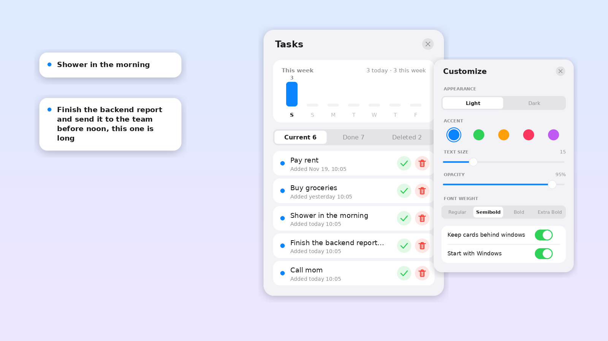
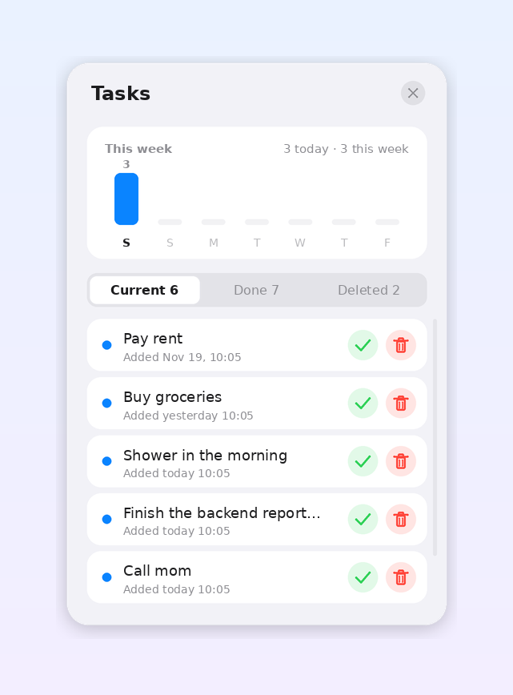
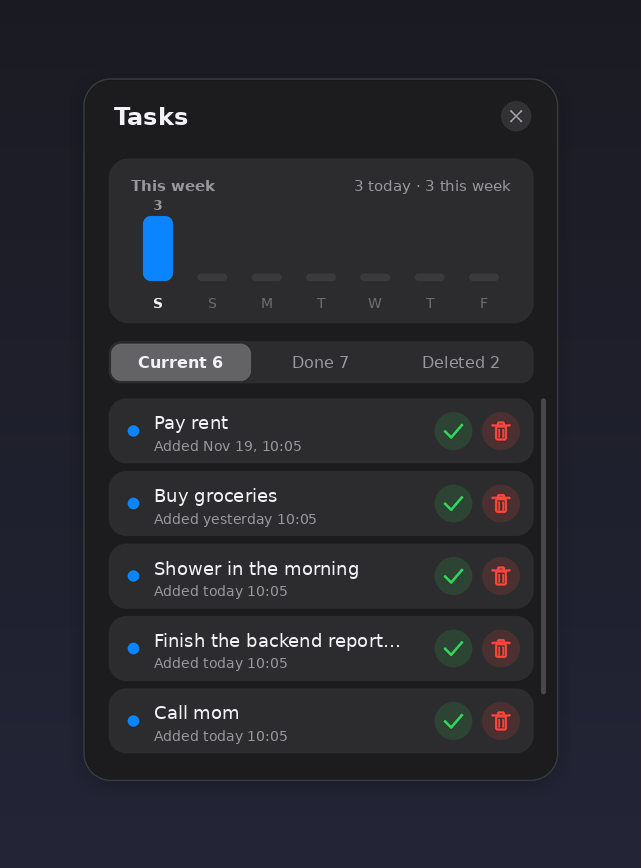
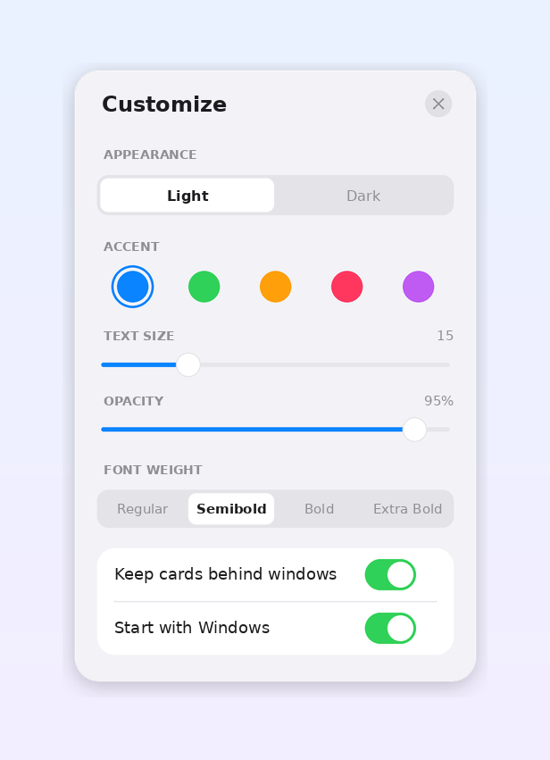
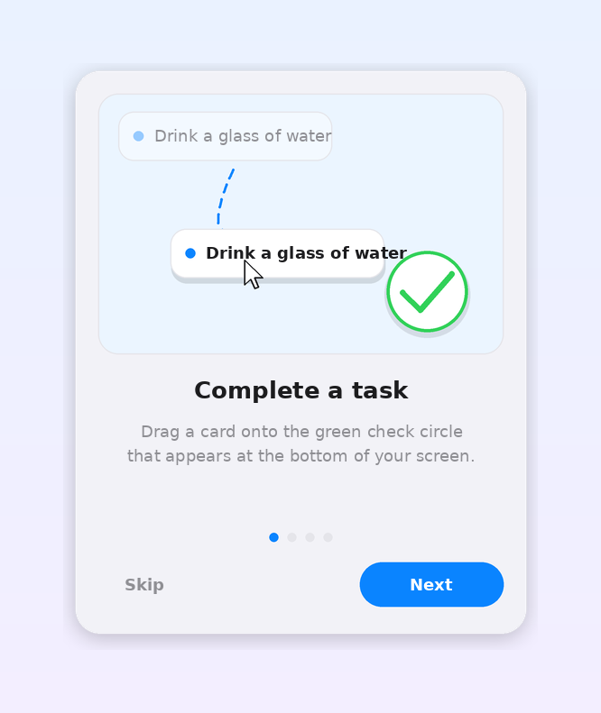
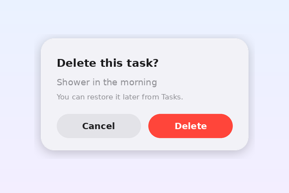
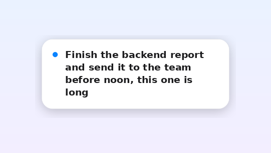

<h1 align="center">DeskTask: minimalist desktop to-do list for Windows</h1>

<p align="center">
  <b>Tiny to-do cards that live on your desktop wallpaper.</b><br>
  Drag a card onto the green check to finish it. Free, open source, no account, no internet.
</p>

<p align="center">
  <a href="https://github.com/mohanaaddd/DeskTask/releases/latest"></a>
  
  <a href="LICENSE"></a>
</p>

<p align="center">
  
</p>

**DeskTask** is a lightweight **desktop task manager and to-do widget for Windows 10 and 11**. Instead of hiding your tasks inside another app, each task becomes a small, clean, Apple-style card pinned to your desktop wallpaper, always visible and never in the way. It sits quietly in the system tray, uses almost no memory, and works completely offline.

## Why DeskTask

- **Tasks you actually see.** Cards stay on your desktop behind your windows, like sticky notes with better taste.
- **Satisfying to finish.** Drag a card onto the animated green check button to complete it.
- **Fast to add.** Press **Ctrl+Alt+N** from anywhere and type.
- **Safe to delete.** Right-click a card and confirm. Deleted tasks wait in the Deleted tab, so you can restore them.
- **See your progress.** A weekly chart (Saturday to Friday) shows how many tasks you finished each day.
- **Made to look good.** Rounded cards, soft shadows, light and dark themes, five accent colors, four font weights, adjustable size and opacity.
- **Private by design.** No account, no cloud, no telemetry. Your tasks stay in a small file on your PC.

## Screenshots

| Tasks window | Dark theme | Customize |
|---|---|---|
|  |  |  |

| First-run tutorial | Delete confirmation | A task card |
|---|---|---|
|  |  |  |

> The images above are renders of the app's interface. Replace them with real screenshots (Win+Shift+S) of your own desktop for the most authentic look.

## Download

1. Open the **[latest release](https://github.com/mohanaaddd/DeskTask/releases/latest)**.
2. Download **DeskTask.exe** and run it. No installer, no admin rights.
3. Look for the DeskTask icon in the system tray (click the **^** arrow if it is hidden).

> **Windows SmartScreen:** new, unsigned apps can trigger a "Windows protected your PC" notice. Choose **More info > Run anyway**. You can verify the download against the `DeskTask.exe.sha256` file attached to each release, or build it yourself from source (below).

## How to use

| Do this | To get this |
|---|---|
| Double-click the tray icon | Open your task list and weekly progress |
| Right-click the tray icon | Add task, Tasks, Customize, How to use, Start with Windows, Exit |
| Press **Ctrl+Alt+N** | Add a task from anywhere |
| Drag a card onto the green check | Mark it as completed |
| Right-click a card | Delete it (with confirmation, and restorable) |
| Drag a card anywhere | Move it. Positions are remembered |

The first time you run DeskTask, a short visual tutorial and three starter tasks show you the ropes. You can replay it any time from **How to use** in the tray menu.

## Build from source

You need Python 3.10 or newer on Windows.

```bash
git clone https://github.com/mohanaaddd/DeskTask.git
cd DeskTask
pip install -r requirements.txt
pythonw DeskTask.py
```

To build your own `DeskTask.exe`, double-click **build.bat**, or run:

```bash
pip install pyinstaller
python -m PyInstaller --noconfirm --clean --onefile --windowed --name DeskTask --icon icon.ico --hidden-import pystray._win32 DeskTask.py
```

The executable appears in `dist/`. Pushing a version tag such as `v1.0.0` also builds and publishes it automatically through GitHub Actions.

## Where is my data stored?

Everything is saved locally in `%APPDATA%\DeskTask` (tasks, settings, card positions and your progress history). Nothing is sent anywhere. To start fresh, close DeskTask and delete that folder. If something goes wrong, `error.log` and `crash.log` in the same folder help with bug reports.

## FAQ

**Is DeskTask free?** Yes. It is open source under the MIT license.

**Does it work on Windows 11 and Windows 10?** Yes, on both. It is built for Windows only.

**Is there a sticky-notes or desktop-widget alternative that stays on the wallpaper?** That is exactly what DeskTask is: a minimal desktop widget to-do list, without the setup of tools like Rainmeter.

**Does it start with Windows?** Turn on **Start with Windows** from the tray menu or the Customize window.

**Why do the cards disappear behind my windows?** That is intentional, so they stay part of your desktop. You can change it with **Keep cards behind windows** in Customize.

**Does it need internet or an account?** No.

## Contributing

Bug reports and ideas are welcome. Please open an [issue](https://github.com/mohanaaddd/DeskTask/issues) and attach `error.log` and `crash.log` from `%APPDATA%\DeskTask` if the app misbehaved. Pull requests are appreciated.

## License

[MIT](LICENSE)

<sub>Keywords: desktop to-do list, desktop task manager, task widget for Windows 11, sticky notes alternative, wallpaper to-do widget, minimalist productivity app, system tray task app, Python tkinter pystray.</sub>
